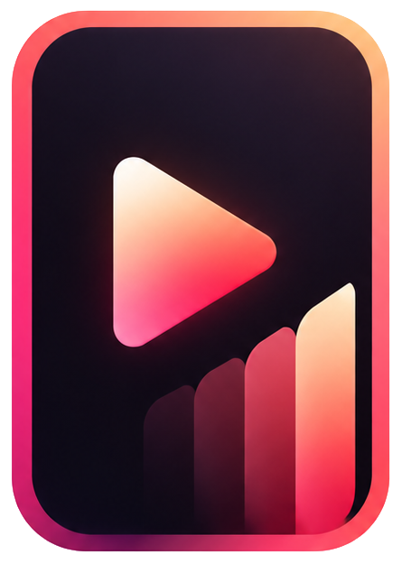

# The Ending

A vertical short-drama app: 1–3 minute episodes, swiped full screen, in the style of the leading Chinese short-drama apps.

## Platforms

| Folder | Platform | Stack |
| --- | --- | --- |
| `Go/` | Backend API | Go, PostgreSQL |
| `Kotlin/` | Android | Kotlin, Jetpack Compose, Media3 |
| `Swift/` | iOS | Swift, SwiftUI, AVPlayer |
| `NextJS/` | Web | Next.js (responsive; same design as the apps) |

All platforms live in this one repository.

## Status

Design phase. No app code yet.

- Screen design: in progress in Claude Design. See [docs/DESIGN.md](docs/DESIGN.md) for the full screen inventory and progress.
- Design source: [design/canvas/](design/canvas/) (Claude Design `.dc.html` artboards).
- Logo: [design/logo/](design/logo/).

## Product model

- Free first episodes, then each episode unlocks with coins, a rewarded ad, or VIP.
- VIP subscription unlocks every episode with no ads.
- Daily check-in and tasks give free coins.
- Sign in with Google (primary), email one-time code, or Apple on iPhone and iPad.
